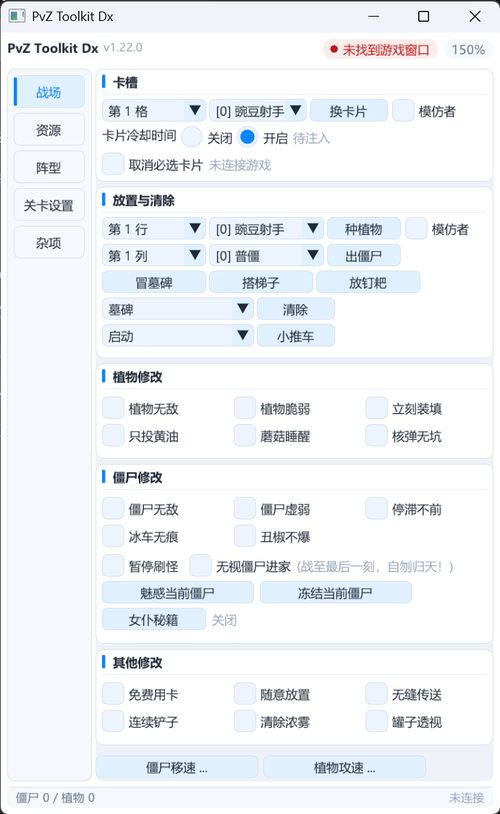
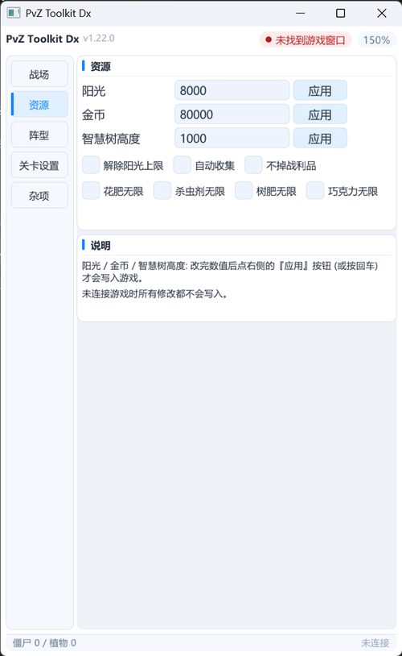
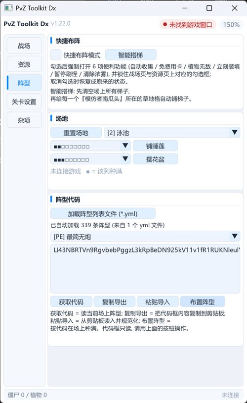
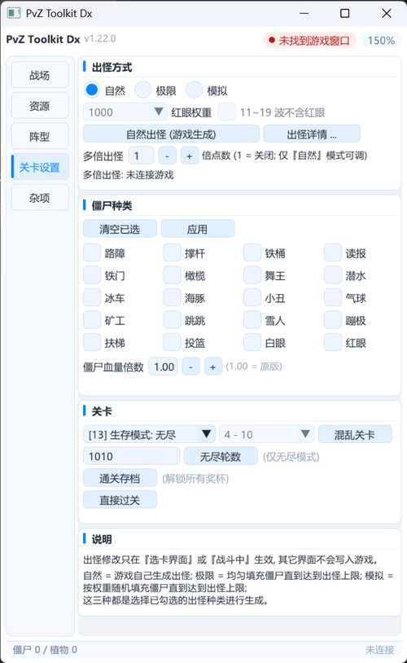
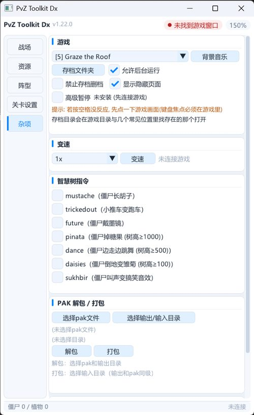
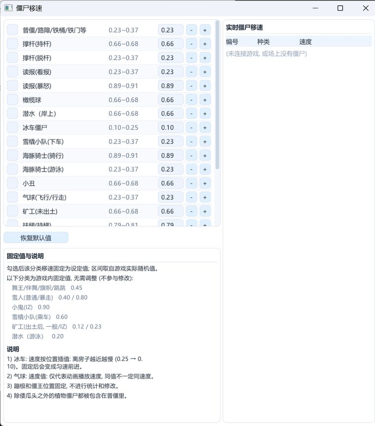
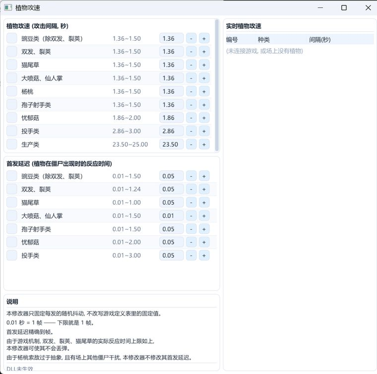

# PvZ Toolkit Dx

**《植物大战僵尸》一代电脑版的辅助工具（修改器）—— `PvZ Toolkit` 的修改版（fork）。**

> ⚠️ 本仓库**不是**上游官方发布。原版项目是 **PvZ Toolkit**（原作者 **lmintlcx**，GPL-3.0）；
> 本修改版依据的上游版本是 **PvZ Toolkit 1.22.0 (2024-06-22)**，修改版作者 **SilenceWoods**。
> 本项目以 **GPL-3.0** 继续开源，保留原作者署名，**完全免费，请勿购买或转售**。

---

## 简介

一个直接读写游戏进程内存的免安装绿色工具（32 位）：
把主程序 exe + `pztk_hook.dll` + `使用说明.txt` 放在同一个文件夹里，启动即可用，删目录即卸载。

界面已从上游的 FLTK 重做为 **Dear ImGui**（5 个页面：战场 / 资源 / 阵型 / 关卡设置 / 杂项），
核心功能逻辑来自上游原版，本修改版在其之上做了**功能增补**与**界面重做**。

主要面向**英语原版 1.0.0.1051 及其汉化版本**（这个版本上所有功能都能用）；其它版本也能连上，
但版本相关的功能会如实显示「未生效 / 未命中」，并且**宁可不用也不会乱改游戏**。

---

## 界面

5 个页面：**战场 / 资源 / 阵型 / 关卡设置 / 杂项**，外加 3 个独立子窗（僵尸移速、植物攻速、出怪数量统计）。
界面风格是浅色底 + 蓝色强调、白卡片分组；桌面分辨率和 DPI 缩放都会自动适配。

> 下面是 **v1.22.0（2026-10-15）** 的实机截图 —— 为了不撑大仓库，都缩成了小尺寸 JPG
> （点开可以看大图；原始 PNG 在开发仓库的 `backup\shots\`）。
> 截图里显示「未连接游戏」是因为**没开游戏**：所有数值/开关都还是默认状态，能看出界面长什么样。

### 5 个主页面

| 战场 | 资源 | 阵型 |
| :--: | :--: | :--: |
|  |  |  |
| **关卡设置** | **杂项** | |
|  |  | |

### 2 个独立子窗

| 僵尸移速（20 个分类可调 + 实时监测） | 植物攻速（攻击间隔 + 首发延迟） |
| :--: | :--: |
|  |  |

> 第 3 个子窗是「出怪数量统计」（按种类 × 波数统计 / 原始列表 20 波 × 50 槽，可存 `.zbl`），
> 它要有游戏数据才有内容，所以没放空表截图。

---

## 功能列表

### 数值精调（本修改版新增的重点）

| 功能 | 说明 |
|---|---|
| **僵尸移速** | 20 个分类可调 + 6 个分类固定值说明。工具只固定"每帧的随机抖动"，不改游戏定义表里的固定值；带实时监测器，可看到场上每只僵尸的速度。冰车速度按位置插值（离房子越近越慢），固定后变成匀速 |
| **植物攻速** | 9 个分类的**攻击间隔**可调；地刺 / 大嘴花由动画倒计时驱动，无字段可写，只列出说明 |
| **首发延迟（前摇）** | 精确到**帧**（1 帧 = 0.01 秒）地控制"植物看到僵尸 → 打出第一发"的反应时间；由配套的 `pztk_hook.dll` 在游戏自己的帧里执行（窗口左下角显示 `DLL已生效` / `DLL未生效`） |

### 战场

* **卡槽**：把任意选卡槽位的植物换成想要的植物（可选模仿者版本）；
  另有 **「取消必选卡片」** —— 冒险模式二周目 Crazy Dave 强塞的 3 张预选卡可以点掉。
* **放置与清除**：批量种植物 / 出僵尸 / 冒墓碑 / 搭梯子 / 放钉耙 / 清除对象 / 小推车（启动·删除·恢复）。
* **植物修改**：植物无敌 / 植物脆弱 / 立刻装填 / 只投黄油 / 蘑菇睡醒 / 核弹无坑。
* **僵尸修改**：僵尸无敌 / 僵尸虚弱 / 停滞不前 / **冰车无痕**（真正不产生冰道）/ 丑椒不爆 /
  暂停刷怪 / 无视僵尸进家（战至最后一刻，自刎归天！）/ 魅惑当前僵尸 / 冻结当前僵尸 /
  **女仆秘籍**（舞王相位四档）。
* **其他修改**：免费用卡 / 随意放置 / 无缝传送 / 连续铲子 / 清除浓雾 / 罐子透视。

### 资源

阳光（0~9990）、金币（0~99999）、智慧树高度（0~1000）、解除阳光上限、自动收集、不掉战利品、
花肥 / 杀虫剂 / 树肥 / 巧克力无限。

### 阵型

* **快捷布阵模式**（一键把 6 项便利功能打开并锁住对应勾选框）、智能搭梯。
* **场地**：按场景（白天 / 黑夜 / 泳池 / 雾夜 / 屋顶 / 月夜）重置，按列预设范围铺睡莲 / 摆花盆。
* **阵型代码**：获取当前场上阵型 → 复制导出 / 粘贴导入 / 一键布置。
* **`.yml` 阵型列表**：放在**程序同目录**会被自动加载（多个文件一起加载），也可手动导入；
  格式是首行 `#! pvztoolkit`，之后每行 `"阵型名称": 阵型代码`（UTF-8）。

### 关卡设置

* **出怪方式**：自然（游戏自己生成）/ 极限（均匀填充到上限）/ 模拟（按权重随机填充到上限），
  三者都只使用你勾选的那些僵尸种类；红眼权重、11~19 波不含红眼（仅极限 / 模拟可调）。
* **多倍出怪**：把游戏自己的**出怪点数预算 ×N**（1~24，1 = 关闭，**仅自然模式可调**）；
  挑哪种僵尸仍由游戏决定。固定刷出的僵尸（旗帜波先塞的普僵、新僵尸介绍、末波巨人等）不参与倍增，
  每波仍受 50 只上限限制。
* **出怪数量统计窗口**：按种类 × 波数统计，或看原始列表（20 波 × 50 槽）；可保存 / 加载 `.zbl`。
* **僵尸种类**：20 个勾选框（普通 / 旗帜僵尸由游戏基础出怪自动算入）；**僵尸血量倍数**（1.00 = 原版）。
* **关卡**：73 种模式、冒险关卡号、混乱关卡、无尽轮数、直接过关、通关存档（解锁全部奖杯）。

### 杂项

* **游戏**：背景音乐（12 首）、打开存档文件夹、允许后台运行（默认勾选）、禁止存档删档、
  显示隐藏页面（解锁隐藏关卡，默认勾选）、**高级暂停**。
  > **高级暂停**：把游戏自带的暂停（按空格）变成"不弹暂停框、音乐不停、鼠标 / 选卡 / 种植 / 铲子照常，
  > 但整个世界连同特效一起冻住"；再按一次空格继续。注意按空格前**键盘焦点必须在游戏里**
  > （先点一下游戏画面）。
* **变速**：10x / 5x / 2x / 1x / 0.5x / 0.2x / 0.1x。
* **智慧树指令**：勾选即发送对应按键序列，发完会**回读游戏状态核对**并显示「已生效 / 未生效」。
* **PAK 解包 / 打包**：解包游戏 PAK 到指定目录；打包产物自动生成在输入目录的上一级（`main_<时间戳>.pak`）。
* **关于 / 文档**：显示版本、编译时间、原作者与修改版作者、GPL 与免责声明；
  「文档」按钮打开程序同目录的 `使用说明.txt`。

> 完整的界面逐项说明、常见问题与已知副作用，见 **[`docs/使用说明.txt`](docs/使用说明.txt)**。
> ★ 本包是**可上传的精简源码包**：开发内部材料（完整交接文档、完整改动日志、维护规程、
> 发布者清单、离线自测 `recttest` 与 QA 脚本）**不随包发布**，只在开发仓库里 ——
> 所以你在源码注释里看到的 `recttest` / 完整 CHANGELOG 等提法，指的是开发仓库里的那份。

---

## 下载与运行

1. 从 Releases 下载绿色包并解压。包内 6 个文件：`PvZ-Toolkit-Dx_v1.22.0.exe`（主程序）/
   `pztk_hook.dll`（注入组件）/ `lineup.yml`（阵型列表，可删）/ `使用说明.txt` / `版本说明.txt` /
   `THIRD-PARTY-NOTICES.txt`（许可）。
2. **把主程序 exe 与 `pztk_hook.dll` 放在同一个文件夹里**，然后运行主程序；
   `使用说明.txt` 也放旁边（程序的「文档」按钮按文件名打开它）。
   `pztk_hook.dll` 缺失、或与 exe 不是同一次构建的一对时，首发延迟会退回兼容方式（界面上会写明）。
3. 建议放在**有写入权限的普通目录**（桌面 / 游戏目录 / 自建目录）。不要放在 `C:\Program Files`
   这类受保护目录，否则解包输出、保存出怪列表可能失败。
4. 本项目**不包含**任何游戏本体或游戏资源，使用时请自备正版游戏。

> exe 与 dll 是**成对**的：控制块版本 `kVersion` 与 DLL 构建号 `kDllBuild` 必须匹配，
> 否则界面会直接报「★版本不符」。

---

## 从源码构建

工具链是 **MinGW-w64 i686**，构建脚本都在 `env/scripts/` 下。

> ⚠️ **第一步：先把工具链放好 —— 它不随本包分发。** `env/scripts/download_deps.py` **只下载**
> winlibs 的 i686 压缩包到 `env/downloads/`，**不会解压**；必须自己把整个 zip 解压到
> **`env\mingw32\`**（应能看到 `env\mingw32\bin\gcc.exe`，且 `gcc --version` 能跑）。
> 缺了它，`env/scripts/provision.cmd` 会直接报 `toolchain not found` 并退出。
> 详见 [`BUILD.md`](BUILD.md) 的 **0.1（第一步 / Step 0）** 与 1.2。

本源码包只构建**两个目标**：ImGui 主程序 `pztk_imgui.exe` 与注入 DLL `pztk_hook.dll`。

> **关于 FLTK**：本包**不含 FLTK 前端源码**（上游的 FLTK 界面版 `pvztoolkit.exe` 及其构建脚本已从包内移除）。
> 但 ImGui 版构建需要的 **zlib** 目前仍来自 FLTK 的源码树：只静态链接其中的 `libfltk_z.a`
> （`.zbl` 阵型与 PAK 打包的压缩；核心层也 `#include <FL/images/zlib.h>`），
> **仅作 zlib 来源**。zlib 源码由 `env/scripts/download_deps.py` 取（不随包分发），
> **FLTK 本体不参与构建、不随包分发**。包内的 **`env/scripts/build_zlib.cmd` 可以只编 zlib**
> （配置 `FLTK_USE_SYSTEM_ZLIB=OFF`、只构建 CMake 目标 `fltk_z`），**不会编译 FLTK 界面**；
> `build_all.cmd` 在 `libfltk_z.a` 缺失时会自动调用它。

👉 **完整步骤见 [`BUILD.md`](BUILD.md)**：**先把工具链解压到 `env\mingw32`（0.1 第一步 / Step 0）**
→ 下载依赖 → 解压第三方源码 → 建 ASCII 路径别名
→ 只编 zlib（`build_zlib.cmd`，来自 FLTK 源码树）与 GLFW → 构建 ImGui 主程序与注入 DLL。

---

## 目录结构

```
.
├── BUILD.md              从零构建步骤（工具链 / 依赖 / 两个目标）
├── LICENSE               GPL-3.0 全文
├── README.md             本文件
├── THIRD-PARTY-NOTICES.txt  第三方组件与许可（含各许可全文的仓库内路径）
├── docs/
│   ├── 使用说明.txt      ★ 面向玩家的完整说明（会随发布包一起分发）
│   └── screenshots/      7 张界面截图（小尺寸 JPG，README 里引用；原始 PNG 在开发仓库）
├── env/
│   └── scripts/          构建与依赖脚本（provision / download_deps / build_zlib / build_glfw /
│                         build_imgui_demo / build_hook_dll / build_all / gen_glyphs / gen_cd_font）
│                         ★ build_zlib.cmd 只编 FLTK 源码树里的 zlib，不编 FLTK 界面
└── tool-src/             工具本体源码
    ├── frontend/         Dear ImGui 前端（imgui_main.cpp —— 主程序入口，imgui_glyphs.h 中文字形表）
    ├── hook/             注入 DLL（hook_main.cpp + 共享控制块 hook_ctl.h + MinHook）
    ├── src/              核心层（pvz / data / process / code / lineup / names / pak / utils）
    ├── inc/              头文件
    ├── res/              程序资源（图标 logo.ico、版本信息 version_imgui.rc、清单 pvztoolkit.manifest）
    ├── CHANGELOG.md      ★ 精简占位版：只留构建戳需要的日期标题 + 说明。
    │                       **不要删** —— 删了构建戳会回退、产物不再与官方一致；
    │                       完整开发日志在开发仓库，不随包发布
    └── CMakeLists.txt    说明性标记文件（本包不用 CMake 构建，见文件头注释；
                          同时是 provision.cmd 的 ASCII 别名哨兵，不能删）
```

> ★ 本包是**有意裁剪**的可上传子集（2026-10-15：79 → 64 个文件 —— 删掉 23 个开发内部件得 57，
> 再加 7 张界面截图）：上游 FLTK 界面版（`pvztoolkit.exe`）的源码与构建链、以及开发期的
> 内部文档 / 自测工具 **都不在这里**。**不要**把开发仓库整树同步进来，否则被移除的内容会被带回来。

---

## 许可与致谢

* 许可：**GNU GPL-3.0**（见 [`LICENSE`](LICENSE)）。再发布必须保留原有版权声明、以 GPL-3.0 继续开源，
  并提供完整对应源码，不得附加额外限制。
* **原版项目**：[PvZ Toolkit](https://github.com/lmintlcx/pvztoolkit) —— 原作者 **lmintlcx**（GPL-3.0）。
  本工具的核心功能与全部技术积累都来自这个项目，本修改版只是在其之上做了增补与界面重做。
* 原版项目最初参考：**PVZ Helper 1.8.7**（原始作者 zhumxiang）。
* 第三方组件：**MinHook**（BSD-2-Clause）、**Dear ImGui**（MIT）、**GLFW**（zlib/libpng），
  以及**构建期依赖 zlib**（来自 FLTK 源码树，zlib license）—— 详见 [`THIRD-PARTY-NOTICES.txt`](THIRD-PARTY-NOTICES.txt)。
  本包**不含 FLTK 前端源码**：FLTK 源码只在 `env\scripts\download_deps.py` 里作为 **zlib 来源**被获取，
  不随包分发，FLTK 本体也不参与构建。
* 第三方组件一览（名称 / 用途 / 许可 / 版权行 / 许可全文的仓库内路径）：
  [`THIRD-PARTY-NOTICES.txt`](THIRD-PARTY-NOTICES.txt)（本包根目录一份；开发仓库根目录另有一份同内容副本）。

---

## 免责声明

* 本工具**仅供单机娱乐与学习交流**使用。**请勿用于联机 / 对战作弊**，**请勿出售或用于任何商业用途**。
* 使用修改器可能造成游戏进度异常、存档损坏或成绩不被承认。「通关存档」「直接过关」等功能会
  改写游戏进度，**使用前请自行备份存档**。
* 请自行承担使用本工具带来的一切后果；因使用本工具造成的任何损失，作者与发布者不承担责任。
* 本项目与 PopCap Games / EA 无任何关联，不包含也不分发任何游戏本体或游戏资源文件。
